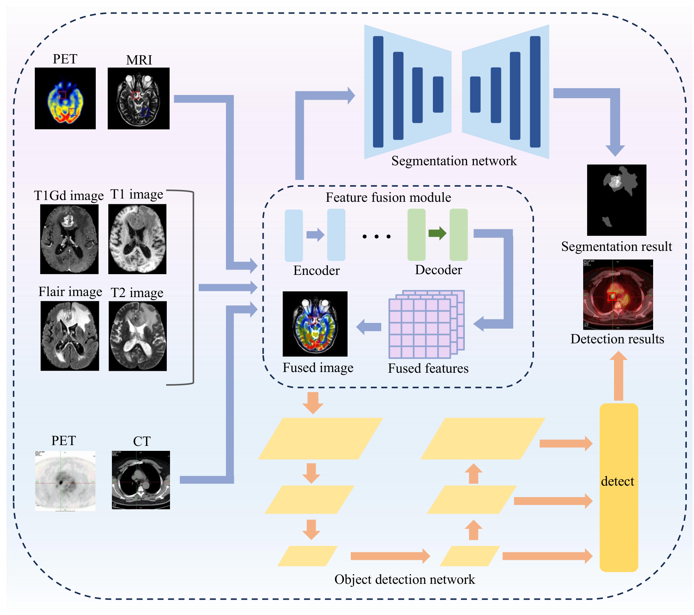

# Task-Oriented Clinical Applications

## Overview

This folder mirrors Section 5 of the survey. Fusion is rarely the endpoint: it supports a clinical task. The four task families here differ in input, output and metric, so a fused image that looks good is not automatically useful for the task.

*Figure 8 of the manuscript: fused-image generation, segmentation, detection and classification.*

| Task | Input | Output | Typical metrics | Folder |
|---|---|---|---|---|
| Fused-image generation | Registered source pair | Fused image | MI, Q^AB/F, SSIM, VIF, visual rating | [Fused_image_generation/](Fused_image_generation/Fused_image_gen.md) |
| Segmentation | Fused image or multi-channel sources | Voxel/pixel labels | DSC, HD95, IoU | [Segmentation/](Segmentation/Seg.md) |
| Detection | Fused image or source pair | Boxes or lesions | mAP, sensitivity, false positives per case | [Detection/](Detection/Detection.md) |
| Classification | Fused image or features | Class label | Accuracy, AUC, sensitivity/specificity | [Classification/](Classification/Cls.md) |

## Two evaluation questions

**Does fusion help the task?** The comparison must be against the same task model trained on the same data without fusion, not against a different architecture. Task gains reported without this control do not establish a benefit of fusion.

**Does the task benefit transfer?** A gain on a public benchmark with a fixed split is internal evidence. External validation, a reader study, or a prospective evaluation is needed before the gain can be called clinical.

## Relation to the evaluation framework

The metric families used in these folders follow Table 10 of the manuscript: source-referenced measures, output statistics, task performance, efficiency, and robustness. The metric-frequency analysis in Fig. 9 shows that task-level measures remain uncommon, which is the gap these folders are intended to make visible.
