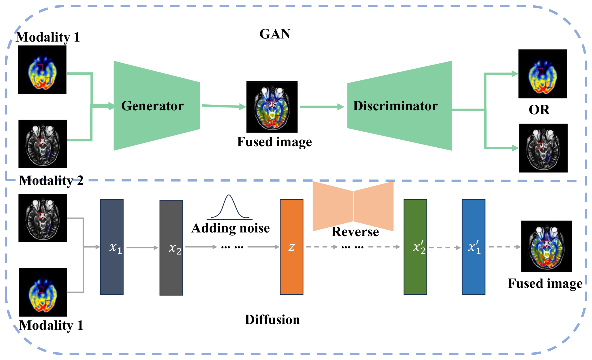

# Generative Model Fusion

## Overview

Generative fusion uses a learned image prior to construct or restore an image. Three formulations are common, and they differ in what is available at inference time:

1. **Adversarial fusion** learns a source-preserving generator with a discriminator. DDcGAN separates source-content and adversarial objectives with two discriminators; U-Patch GAN works at patch level to preserve texture; AdvTCUnet couples generation with a downstream segmentation objective.
2. **Diffusion fusion** starts from a pretrained prior and conditions it on the sources. DDFM uses Bayesian source conditioning without a ground-truth fused target; DM-FNet decouples diffusion-based feature reconstruction from the fusion stage to reduce inference cost; Mask-DiFuser and DRMF extend masked diffusion to unsupervised and multi-task settings.
3. **Modality synthesis** estimates an absent input before fusion. It is often grouped with generative fusion, but its output is a missing modality rather than a fused image, so it is evaluated with synthesis metrics and downstream task scores.

*Figure 5 of the manuscript: GAN-based fusion, diffusion-based fusion, and modality synthesis.*

## Representative studies

| Title | Venue, Year | DOI |
|---|---|---|
| DDcGAN: A Dual-Discriminator Conditional Generative Adversarial Network for Multi-Resolution Image Fusion | IEEE Transactions on Image Processing, 2020 | [10.1109/tip.2020.2977573](https://doi.org/10.1109/tip.2020.2977573) |
| U-Patch GAN: A Medical Image Fusion Method Based on GAN | Journal of Digital Imaging, 2023 | [10.1007/s10278-022-00696-7](https://doi.org/10.1007/s10278-022-00696-7) |
| Multi-Modality Medical Image Segmentation via Adversarial Learning with CV Energy Functional | Expert Systems with Applications, 2025 | [10.1016/j.eswa.2025.127467](https://doi.org/10.1016/j.eswa.2025.127467) |
| DDFM: Denoising Diffusion Model for Multi-Modality Image Fusion | Proceedings of the IEEE/CVF international conference on computer vision, 2023 | [10.1109/iccv51070.2023.00742](https://doi.org/10.1109/iccv51070.2023.00742) |
| DM-FNet: Unified Multimodal Medical Image Fusion via Diffusion Process-Trained Encoder-Decoder | IEEE Transactions on Multimedia, 2025 | [10.1109/tmm.2025.3613156](https://doi.org/10.1109/tmm.2025.3613156) |
| Mask-DiFuser: A Masked Diffusion Model for Unified Unsupervised Image Fusion | IEEE Transactions on Pattern Analysis and Machine Intelligence, 2026 | [10.1109/tpami.2025.3609323](https://doi.org/10.1109/tpami.2025.3609323) |
| DRMF: Degradation-Robust Multi-Modal Image Fusion via Composable Diffusion Prior | Proceedings of the 32nd ACM International Conference on Multimedia, 2024 | [10.1145/3664647.3681064](https://doi.org/10.1145/3664647.3681064) |

## What to record for a generative method

- Whether the method needs paired sources, unpaired sources, or a missing modality.
- Whether a ground-truth fused image exists; if not, how fidelity is assessed.
- The inference cost: diffusion methods require iterative sampling unless distilled.
- The failure mode: hallucinated structure, changed lesion appearance, or vanished small vessels.

## Evidence status

Generative fusion is the direction with the largest gap between reported image-quality scores and clinical validation. Most entries report MI, Q^AB/F, SSIM or FID on benchmark pairs; reader studies and task-level validation remain rare.
