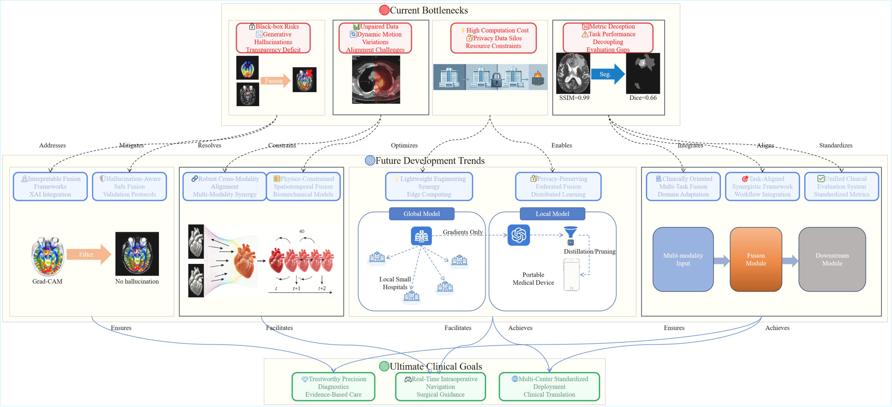

# Open Source: Datasets, Tools and Evaluation

## 📌 Overview

This folder mirrors Section 6 of the survey. It separates four kinds of resource that are often conflated: public datasets, preprocessing tools, training frameworks, evaluation and visualization utilities, and deployment tools.

| Folder | Content | Manuscript |
|---|---|---|
| [`Datasets/`](Datasets/dataset_list.md) | Ten public datasets used in MMIF studies | Section 6.2, Table 9 |
| [`Data_Preprocessing/`](Data_Preprocessing/tool_list.md) | Registration, resampling, normalization, ROI handling | Section 6.1 |
| [`Model_design_and_training_frameworks/`](Model_design_and_training_frameworks/mdtf_list.md) | Frameworks for building and training fusion models | Section 6.3 |
| [`Evaluation_and_visualization/`](Evaluation_and_visualization/evalvisual_list.md) | Metrics, statistical testing, figures | Section 6.4 |
| [`Deployment_and_inference/`](Deployment_and_inference/DeployInfer_list.md) | Export, optimization, packaging | Section 6.5 |

*Figure 9 of the manuscript: which metric families the 192 surveyed studies actually report.*

## 📋 Tables

- [Table 8 — software components](../tables/table8_tools.md)
- [Table 9 — public datasets](../tables/table9_datasets.md)
- [Table 10 — evaluation system](../tables/table10_evaluation.md)

## 🔁 Reproducibility protocol

Section 6.6 of the manuscript specifies a paired-image protocol: fixed registration and resampling, stated intensity normalization, one metric implementation with parameters, and a reported split. The repository records the same fields so that a reported score can be traced to a configuration.

A tool is listed because it performs a defined step, not because it has been used in a reproduced pipeline. The survey therefore separates availability from evidence: a link to code is not a reproduction, and a reported metric is not an external validation.

## 🚫 What is not covered

Commercial clinical platforms, regulatory-cleared software, and in-house hospital pipelines are outside the scope. Their performance claims usually cannot be checked against public data.
