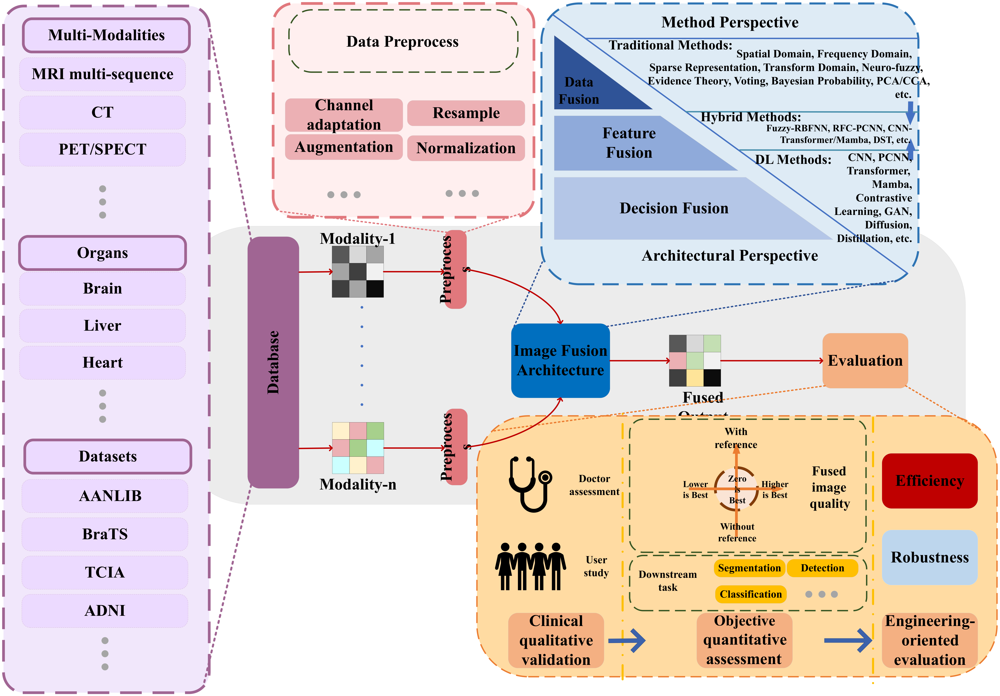
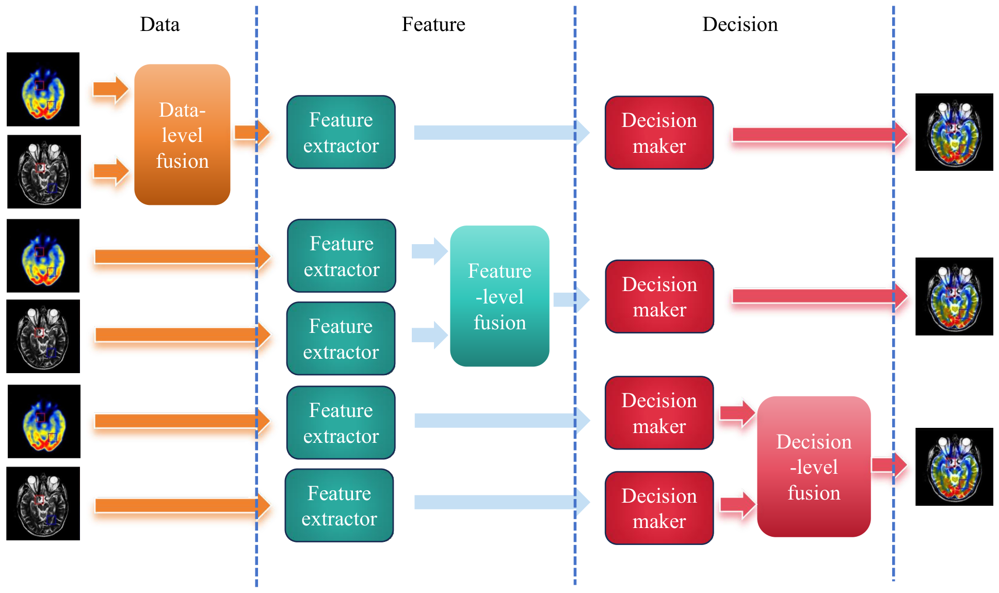

# Technical System: The MMIF Pipeline

## 📌 Overview

This folder mirrors Section 3 of the survey. It follows a single fusion pipeline: images are registered and preprocessed, then combined at one of three levels, and the result is assessed before it can be used clinically.

*Figure 3 of the manuscript: preprocessing, the three fusion hierarchies, and the evaluation stage.*

The three hierarchies are not interchangeable. Data-level fusion keeps the original intensities and is easiest to audit, but it assumes accurate registration. Feature-level fusion tolerates residual misalignment and is the dominant paradigm in deep learning, at the cost of interpretability. Decision-level fusion combines task outputs and can attach reliability to each modality, but it depends on the performance of the individual decision makers.

*Figure 2 of the manuscript: the same source pair processed at the three levels.*

| Paradigm | Unit of combination | Typical output | Main strength | Main risk |
|---|---|---|---|---|
| Data-level | Pixels or voxels | Fused image | Preserves source intensities | Sensitive to registration error |
| Feature-level | Encoded features | Fused image or features | Robust to residual misalignment | Limited traceability |
| Decision-level | Scores or labels | Decision map | Explicit reliability modelling | Depends on base learners |

## 📁 Folders

| Folder | Content | Manuscript |
|---|---|---|
| [`Preprocessing/`](Preprocessing/README.md) | Registration, resampling, intensity normalization, skull stripping, augmentation | Section 3.2 |
| [`Data_Level_Fusion/`](Data_Level_Fusion/README.md) | Pixel/voxel-level methods, traditional and deep | Section 3.3 |
| [`Feature_Level_Fusion/`](Feature_Level_Fusion/README.md) | Encoder-decoder and transformer fusion | Section 3.4 |
| [`Decision_Level_Fusion/`](Decision_Level_Fusion/README.md) | Evidence theory, voting, probabilistic fusion | Section 3.5 |

## 📊 Full study tables

The complete study tables are reproduced in [`tables/`](../tables/README.md):

- [Table 3 — data-level studies](../tables/table3_data_level.md) (48 entries)
- [Table 4 — feature-level studies](../tables/table4_feature_level.md) (153 entries)
- [Table 5 — decision-level studies](../tables/table5_decision_level.md) (10 entries)

## 📝 Reading the entries

Every method entry records the modalities, the fusion level, the reported metrics, and the validation evidence (benchmark, retrospective, external, reader study, prospective, or unclear). The validation label is defined in Section 6.4 of the manuscript; it describes how a study was evaluated and is not a quality score.

Where a study spans more than one level, it appears under each level and is counted once per metric family in the corpus statistics. The per-study extraction is released in [`studies_metric_coding.csv`](../studies_metric_coding.csv).
